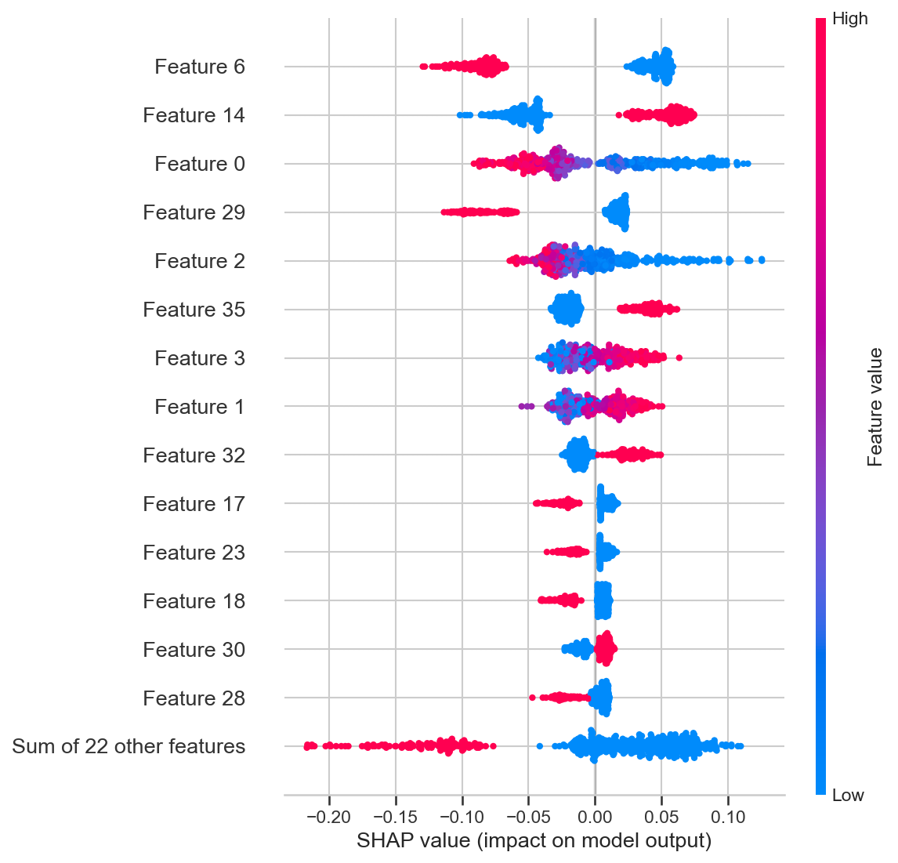
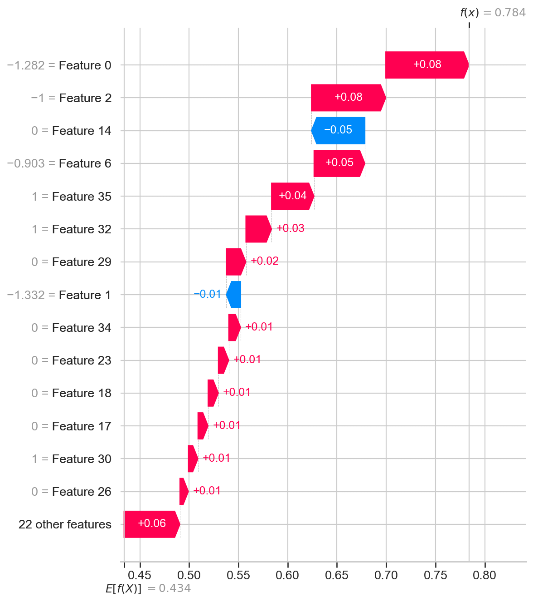
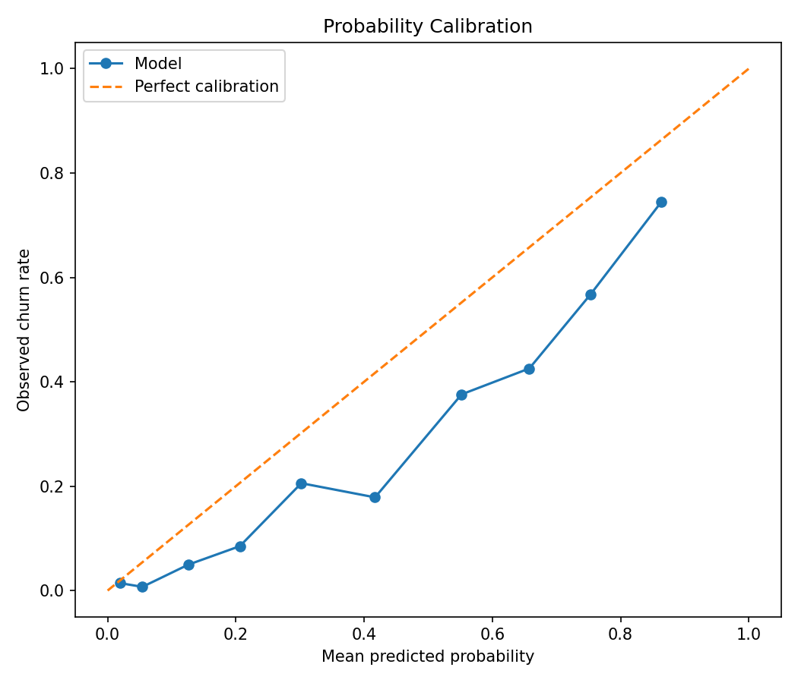

# Telecom Churn Prediction

[](https://github.com/wissemhammami/telecom-churn-prediction/actions/workflows/ci.yml)

End-to-end telecom churn prediction with scikit-learn, XGBoost, FastAPI, and
Streamlit.

## Live Demo

[Open the Streamlit app](https://churn-wissem.streamlit.app)

## Problem Statement

The project predicts which telecom customers are likely to churn so retention
teams can prioritize early intervention. It uses the Telco Customer Churn
dataset from [Kaggle](https://www.kaggle.com/datasets/blastchar/telco-customer-churn):
7,043 customers, 21 raw columns, and `Churn` as the binary target.

## Project Structure

```text
TELECOM-CHURN-PREDICTION/
├── .github/workflows/ci.yml
├── .dockerignore
├── app.py
├── data/
│   ├── new/
│   ├── processed/
│   └── raw/
├── models/
│   ├── champion_model.pkl
│   ├── feature_columns.pkl
│   ├── model_metadata.json
│   └── shap_background.csv
├── reports/
│   ├── calibration.png
│   ├── eda_claims.csv
│   ├── feature_importance.png
│   ├── model_comparison.csv
│   ├── shap_summary.png
│   ├── shap_waterfall_client_1.png
│   ├── threshold_analysis.csv
│   ├── threshold_cost_analysis.csv
│   ├── threshold_test_comparison.csv
│   └── threshold_cost_curve.png
├── scripts/
│   ├── calibration_report.py
│   ├── check_data.py
│   ├── eda_claims_check.py
│   ├── make_shap_background.py
│   └── threshold_cost_analysis.py
├── src/
│   ├── features/
│   ├── inference/
│   ├── interpretability/
│   ├── serving/
│   │   ├── config.py
│   │   ├── explain.py
│   │   ├── main.py
│   │   ├── schemas.py
│   │   └── utils.py
│   ├── tests/
│   │   ├── test_api.py
│   │   └── test_predict.py
│   └── training/
├── Dockerfile
├── requirements.txt
├── runtime.txt
└── start.sh
```

## Installation

The deployment target is Python 3.12. The pinned runtime is defined in
`runtime.txt` and the Dockerfile.

```bash
git clone https://github.com/wissemhammami/telecom-churn-prediction.git
cd telecom-churn-prediction
python -m venv env
source env/bin/activate        # Windows: env\Scripts\activate
pip install -r requirements.txt
```

The CI workflow requires `models/champion_model.pkl` and
`models/shap_background.csv` to remain tracked in the repository.

## Run

```bash
# FastAPI
uvicorn src.serving.main:app --host 0.0.0.0 --port 8000 --reload

# Streamlit
python -m streamlit run app.py

# Tests
python -m pytest src/tests -q
```

The Docker image starts both services:

```bash
docker build -t churn-app .
docker run -p 8000:8000 -p 8501:8501 churn-app
```

## API

| Method | Endpoint | Description |
|---|---|---|
| GET | `/health` | Service and model status |
| POST | `/predict` | Predict one customer |
| POST | `/predict/batch` | Predict 1 to 1,000 customers |
| POST | `/interpret` | Return top SHAP features |

Categorical values are validated against the dataset. Invalid categories,
missing required fields, negative numeric values, and empty batches return
HTTP 422. If the model is unavailable, `/health` returns HTTP 503 and
prediction endpoints return HTTP 503.

Example request:

```bash
curl -X POST "http://localhost:8000/predict" \
  -H "Content-Type: application/json" \
  -d '{
    "tenure": 5,
    "MonthlyCharges": 85.6,
    "TotalCharges": 428.0,
    "gender": "Female",
    "SeniorCitizen": 0,
    "Partner": "Yes",
    "Dependents": "No",
    "PhoneService": "Yes",
    "MultipleLines": "No",
    "InternetService": "Fiber optic",
    "OnlineSecurity": "No",
    "OnlineBackup": "Yes",
    "DeviceProtection": "No",
    "TechSupport": "No",
    "StreamingTV": "Yes",
    "StreamingMovies": "No",
    "Contract": "Month-to-month",
    "PaperlessBilling": "Yes",
    "PaymentMethod": "Electronic check"
  }'
```

Response fields use the English names `risk_level`, `num_churners`, and
`churn_rate_percent`; risk values are `Low`, `Medium`, or `High`.

## Model Selection

Training compares Logistic Regression, Random Forest, and XGBoost with the
same five-fold stratified randomized search. The generated CV results are:

| Model | Mean CV ROC-AUC | Standard deviation |
|---|---:|---:|
| LogisticRegression | 0.8474 | 0.0113 |
| RandomForest | 0.8479 | 0.0103 |
| XGBoost | 0.8469 | 0.0116 |

These models are within cross-validation noise. Random Forest is retained by
the pre-declared rule: highest mean CV ROC-AUC. The untouched-test results at
the production threshold of 0.35 are ROC-AUC `0.8448`, PR-AUC `0.6542`, F1
`0.5971`, precision `0.4540`, and recall `0.8717`.

## Explainability

SHAP uses a committed 100-row background sample in
`models/shap_background.csv`, so explanations work without the raw dataset
in deployed environments.





- The summary plot shows the global distribution of feature contributions.
- Waterfall plots show how one customer's features move the prediction from
  the baseline toward churn or no churn.
- Contributions are calculated for the churn class of the saved champion.

## Business Impact and Threshold

The production threshold is `0.35`, chosen inside the flat `0.35`-`0.50`
training-CV plateau to favor recall. The strict training-CV optimum is `0.40`:
net benefit is `62,190` at `0.35`, `62,330` at `0.40`, and `61,050` at `0.50`.

- Retention offer cost: `20`
- Customer lifetime value: `300`
- Retention success rate: `0.30`

These costs are assumptions, not operator data. On the untouched test set:

| Threshold | Precision | Recall | Net benefit |
|---:|---:|---:|---:|
| 0.35 | 0.4540 | 0.8717 | 14,980 |
| 0.40 | 0.4832 | 0.8449 | 15,360 |
| 0.50 | 0.5394 | 0.7861 | 15,560 |

The differences between these thresholds are within noise. The threshold
should be revalidated with real retention costs and outcomes.

| Threshold | Training-CV net benefit |
|---:|---:|
| 0.20 | 54,220 |
| 0.30 | 60,650 |
| 0.35 | 62,190 |
| 0.40 | 62,330 |
| 0.50 | 61,050 |
| 0.60 | 56,320 |
| 0.70 | 45,980 |

The production threshold should change only after these assumptions are
validated with real retention costs and outcomes.

## Probability Calibration



The held-out-test Brier score is `0.158078`. The aggregate diagnostic is
over-confident; calibration should be monitored before using probabilities as
financial forecasts.

## Verified EDA Claims

The raw dataset verifies:

- Overall churn rate: `26.54%`.
- Month-to-month churn: `42.71%`; one-year: `11.27%`; two-year: `2.83%`.
- Fiber optic churn: `41.89%`; DSL: `18.96%`; no internet: `7.40%`.
- Churn above $70 monthly charges: `35.36%`; at or below $70: `17.40%`.
- Mean tenure is `17.98` months for churners and `37.57` for non-churners.

These measurements support the original directional claims, with the values
recorded in `reports/eda_claims.csv`.

## Limitations and Next Steps

- The source is a public Kaggle dataset, not operator production data.
- Results use one train/test split; broader validation is still needed.
- The model pickle is tied to scikit-learn `1.8.0`; retrain when upgrading
  the model-serving dependency.
- Business costs and retention success are assumptions, not measured outcomes.
- The model is not probability-calibrated for financial planning.
- There is no production drift monitoring yet.
- Batch inference, the API, and Streamlit share the same preprocessing code.
- Streamlit intentionally loads the model directly instead of calling the API
  to keep the free-tier demo simple.
- A Tunisie Telecom deployment would first require a prepaid/postpaid scope,
  an operational churn definition, and call-detail-record features.
- Validate the threshold and monitor drift with real customer outcomes.

## Author

**Wissem Hammami**  
Machine Learning Engineer | Data Science | ESSAI, University of Carthage  
[LinkedIn](https://www.linkedin.com/in/wissemhammami/)
